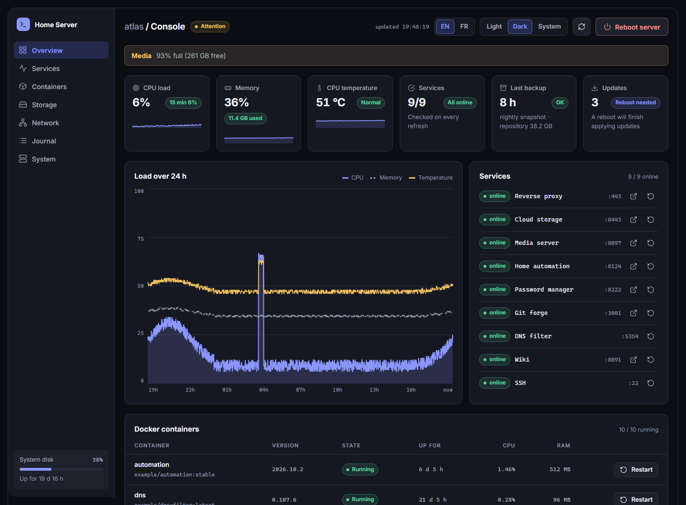
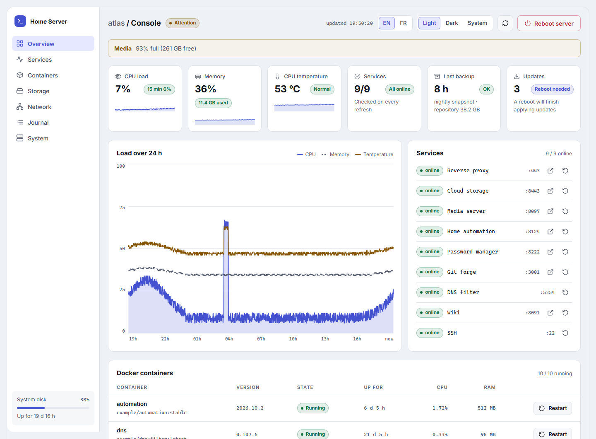
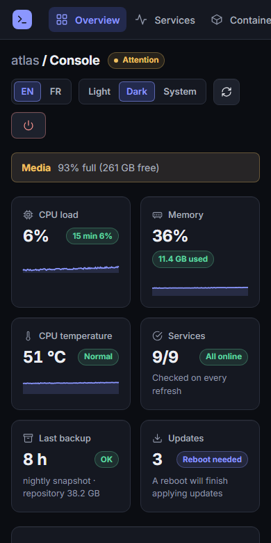

# srv-console

**A lightweight status console for a home server. Enough to see what's going on, and nothing more.**

A status page for a Linux server you run yourself, at home or in a closet. Load, memory and temperature, disks and their SMART health, Docker containers, the services you care about, certificate expiry, pending updates, and whether last night's backup really ran. If you allow it, it can also restart a container or the whole machine.

It isn't Prometheus or Zabbix and doesn't try to be. There is no agent and no metrics database to run: one small PHP app and a systemd timer, no framework, nothing loaded from the internet.



<p>
  
  
</p>

Every screenshot here uses made-up data, see [Try it without a server](#try-it-without-a-server).

## What it shows

- **Six tiles up top**: CPU load, memory, CPU temperature, services, last backup, pending updates. The first three carry a sparkline of the last two hours.
- **A 24 hour chart** of CPU, memory and temperature, one point per minute.
- **All the alerts in one banner**: a service not answering, a container failing its health check, a disk nearly full, a SMART failure, a backup that failed or is too old, a certificate about to expire, security updates waiting, a hot CPU, a collector that stopped. The thresholds are in the config.
- **Docker containers** with state, health, uptime, version, CPU and memory.
- **Disks**: used space per mount point, and the SMART status of each drive with temperature and wear. A drive that is asleep stays asleep.
- **Network**: current rate per interface and a 24 hour download curve.
- **Services**: TCP checks you list yourself, with an "open" link and, if you enable it, a restart button.
- **A journal** of recent events and active alerts, in one scrolling list.
- **Certificates and logins**: Let's Encrypt expiry dates and the last logins.
- English and French (picked from the browser, switchable in the header), dark by default, light and "follow my system" available, readable on a phone.

Everything that needs a command (Docker, `df`, `smartctl`, `last`, apt) is done by a separate collector, never by the web page. That split is the main design decision, explained below.

## How it works

```
browser --> api/state.php --> reads /proc, /sys and /var/lib/srv-console/status.json
                                                    ^
systemd timer, every minute --> srv-console-collect (root) --> docker, df, smartctl, last, certs, apt

browser --> api/action.php --> sudo --> srv-console-action (root) --> docker restart / systemctl
```

The web server runs as an unprivileged user that can't talk to Docker, read SMART data or list logins, and you don't want it to. So a small collector runs as root once a minute, gathers all of that and writes JSON files. The page only reads those files, plus a few things in `/proc` and `/sys` that anyone can read. Requests stay fast, and a bug in the page or an exposed page can't run commands.

The one thing going the other way is the optional restart button, through a root helper that checks every request again, see [Actions](#actions-restart-and-reboot).

## Requirements

- Linux with systemd. It was built and used on Ubuntu 24.04 with Apache 2.4 and PHP 8.3. Debian and other Ubuntu releases should work, anything else is untested.
- PHP 8.1 or newer, both the CLI (for the collector) and whatever your web server uses (mod_php or php-fpm). The `openssl` extension is only needed for the certificate card.
- Apache or nginx. Example configs are in `deploy/`.
- Optional. Each of these only adds a card when it's there: Docker, `smartmontools`, certbot (certificates), `update-notifier-common` (the pending-updates count, Ubuntu), and the `last` command (logins).

## Try it without a server

You don't need a Linux box to look at it. With PHP installed:

```
git clone https://github.com/BriKKou/srv-console.git
cd srv-console
SRV_CONSOLE_DEMO=1 php -S 127.0.0.1:8080 -t public
```

Open http://127.0.0.1:8080. The demo serves a made-up server called "atlas", which is where the screenshots come from. On Windows, set the variable first: `$env:SRV_CONSOLE_DEMO=1` in PowerShell, or `set SRV_CONSOLE_DEMO=1` in cmd.

## Installation

On the server, as root or with sudo.

**1. Put the code in /opt and make it root's.**

```
git clone https://github.com/BriKKou/srv-console.git /opt/srv-console
chown -R root:root /opt/srv-console
chmod 755 /opt/srv-console/bin/*
```

The ownership matters more than it looks. The two scripts in `bin/` run as root and load PHP files from `src/`. If your web user could write there, it could make root run anything. Keep the whole tree owned by root and writable by nobody else.

**2. Create your config.**

```
install -d /etc/srv-console
cp /opt/srv-console/config/config.example.php /etc/srv-console/config.php
```

Edit it. Every option is commented, and whatever you leave out keeps its default, so a config can be five lines long. See [Configuration](#configuration).

**3. Start the collector.**

```
cp /opt/srv-console/deploy/srv-console-collect.{service,timer} /etc/systemd/system/
systemctl daemon-reload
systemctl enable --now srv-console-collect.timer
```

Give it a minute, then check that `/var/lib/srv-console/status.json` exists. If it doesn't, `journalctl -u srv-console-collect` says why.

**4. Serve `public/`.**

Start from `deploy/apache.conf` or `deploy/nginx.conf`. Whichever you pick, protect it with HTTP authentication or restrict it to your LAN: the page has no login of its own. Read [Security](#security) before exposing it beyond your network.

**5. Optional: turn on the restart buttons.** See [Actions](#actions-restart-and-reboot).

## Configuration

The config is a PHP file that returns an array. `config/config.example.php` documents every option. These are the ones you'll touch first:

| Key | What it does |
|---|---|
| `title` | Name shown in the sidebar and the tab |
| `language` | `auto` (browser, with a switch in the header), `en` or `fr` |
| `refresh` | Seconds between two refreshes of the page, 15 by default |
| `services` | The TCP checks, each with a `name`, a `port` and optionally a `url`, a `container` or a `unit` |
| `actions` | Restart and reboot buttons, all off by default |
| `disks.labels` | Friendlier names for mount points |
| `disks.ignore` | Mount points to hide (`/boot/efi` and Docker's own mounts are already hidden) |
| `smart.exclude` | Drives to leave alone |
| `backup.status_file` | Path of the file your backup job writes |
| `thresholds` | When disk and temperature alerts turn orange and red |

A few options also read the environment, mostly for testing: `SRV_CONSOLE_CONFIG` (path of the config), `SRV_CONSOLE_DATA_DIR` and `SRV_CONSOLE_DEMO=1`. The root helper ignores them on purpose.

### Collector

`srv-console-collect` runs as root every minute and writes two files in `data_dir` (`/var/lib/srv-console` by default): `status.json` with the latest snapshot, and `history.json` with the last 24 hours, one point per minute. SMART and the pending-updates count are refreshed every ten minutes instead. If the collector stops for more than five minutes, the page says so.

For SMART, the collector asks `smartctl --scan` for the drives and tries a few device types on each one, because the scan sometimes reports a SATA drive as plain SCSI, which hides its health. Drives in standby are not woken up. Some old drives misbehave when polled: put them in `smart.exclude`, which matches the device path, the `/dev/disk/by-id` names and the model. Some USB enclosures can't be read at all; if you know the right `-d` type, list the drive under `smart.devices`.

### Actions (restart and reboot)

Off by default. When enabled, a restart button appears next to each container, next to each service you tied to a `container` or a `unit`, and an optional reboot button in the header.

```php
'actions' => [
    'enabled'    => true,
    'containers' => ['wiki', 'gitea'],   // or 'all'
    'units'      => ['nginx'],
    'reboot'     => false,
],
```

It works in three layers. The page sends a POST with a custom header, which another website can't send. The endpoint checks the request against your config and against the containers the collector has seen. Then it runs `sudo srv-console-action`, a root script that reads only `/etc/srv-console/config.php`, checks everything again against what exists right now, and only then runs `docker restart` or `systemctl`. Every request, accepted or refused, goes to the system journal: `journalctl -t srv-console-action`.

For sudo to allow it, install the rule from `deploy/sudoers` (change the user name if your web server doesn't run as `www-data`):

```
install -m 440 /opt/srv-console/deploy/sudoers /etc/sudoers.d/srv-console
visudo -cf /etc/sudoers.d/srv-console
```

The reboot button asks for a confirmation, then for you to type REBOOT.

The trade-off, plainly: anyone who can open the page can restart what you allowed. That's why the page must be behind a login or on your LAN before you turn this on.

### Backup status

The backup tile doesn't run backups and doesn't care which tool you use. It reads one small JSON file that your backup job writes when it finishes:

```json
{
  "ok": true,
  "last_run": "2026-10-31T03:30:12+00:00",
  "last_success": "2026-10-31T03:30:12+00:00",
  "detail": "nightly, 12 GB added"
}
```

`ok` says how the last run went. `last_run` and `last_success` are ISO 8601 dates, and `last_success` defaults to `last_run` when `ok` is true. `detail` is optional text shown under the tile, 200 characters at most. Point `backup.status_file` at the file.

From a shell script, at the end of the job:

```sh
status=/var/lib/backup/status.json
now=$(date -Is)
printf '{"ok": true, "last_run": "%s", "last_success": "%s", "detail": "%s"}\n' "$now" "$now" "12 GB added" > "$status.tmp"
mv "$status.tmp" "$status"
```

Write to a temporary name and rename, so the collector never reads half a file. On failure, write `"ok": false` and put the reason in `detail` (no quotes or line breaks in it unless you escape them): it shows up in the alert. The page also raises a warning when the file is missing, and another when the last success is older than `backup.max_age_hours`, 48 by default.

## Security

There is no login in the app. Put it behind your web server's authentication or restrict it to your LAN, and do it for the page, the assets and the API, not only the front page. Both example configs do.

Check your default virtual host too. A request that matches none of your virtual hosts (an IP address, an unknown name) is answered by the first or default one. If that one points at this folder without a login, the whole console is open to anyone who types your IP. Test it: `curl -k https://<your-ip>/` must not return the dashboard.

If someone does get in, they see the host name, interface addresses, container names and images, mount points, and the usernames and source addresses of recent logins. Treat the page as private.

What the app does to protect itself: the web user never runs a command, except through the one root helper described above. The page sends a strict Content-Security-Policy, loads nothing from outside and builds its DOM without `innerHTML`. The API answers 405 to the wrong method, and the page and the API are sent with `no-store`.

And once more, because it's the one that bites: keep `/opt/srv-console` owned by root.

## Troubleshooting

**"The collector hasn't run yet."** Look at `systemctl status srv-console-collect.timer` and `journalctl -u srv-console-collect`. The usual causes are a wrong path in the service file or no PHP CLI installed.

**No containers card.** It hides itself when Docker can't be reached. Run `docker ps` as root: that's what the collector does.

**No temperature.** The page reads the sensor of a known CPU driver (coretemp, k10temp, zenpower, cpu_thermal) and falls back to the first thermal zone. Look at `cat /sys/class/hwmon/hwmon*/name` and `/sys/class/thermal/thermal_zone0/temp`.

**A drive is missing from SMART.** Run `smartctl --scan`, then `smartctl -a /dev/sdX`. If smartctl can't read it, neither can the dashboard. Otherwise check `smart.exclude`.

**No restart buttons.** `actions.enabled` must be true, the container must be in `actions.containers` (or that must be `'all'`) and must have been seen by the collector, and the sudoers rule must exist. Test the last link by hand: `sudo -u www-data sudo -n /opt/srv-console/bin/srv-console-action restart <name>`. If sudo complains that the "no new privileges" flag is set, your PHP-FPM unit is sandboxed with `NoNewPrivileges` and sudo can't work from it.

**The page is in the wrong language.** With `language` on `auto`, the header switch wins (it's kept in a cookie), then the browser. Set `en` or `fr` to force one.

**A blank page and a 401.** That's your web server asking for a login, as intended.

## Repository layout

```
public/            what the web server serves
public/api/        state.php, history.php, action.php
public/assets/     app.js, app.css, the icon, and i18n/ with the English and French strings
src/               the PHP classes
bin/               srv-console-collect and srv-console-action, both run as root
config/            config.example.php
deploy/            systemd units, sudoers rule, Apache and nginx examples
screenshots/       the images in this README, all from the demo data
```

The French version of this file is `README_FR.md`.

## Credits

The look is inspired by the ["Dark developer console dashboard"](https://uicookies.com/snippets/dark-developer-console-dashboard/) snippet from UICookies. None of their files are included here: the HTML, CSS and JavaScript in this repository are written from scratch. The idea of one PHP page for a home server comes from eZ Server Monitor.

## License

MIT, see `LICENSE`.
