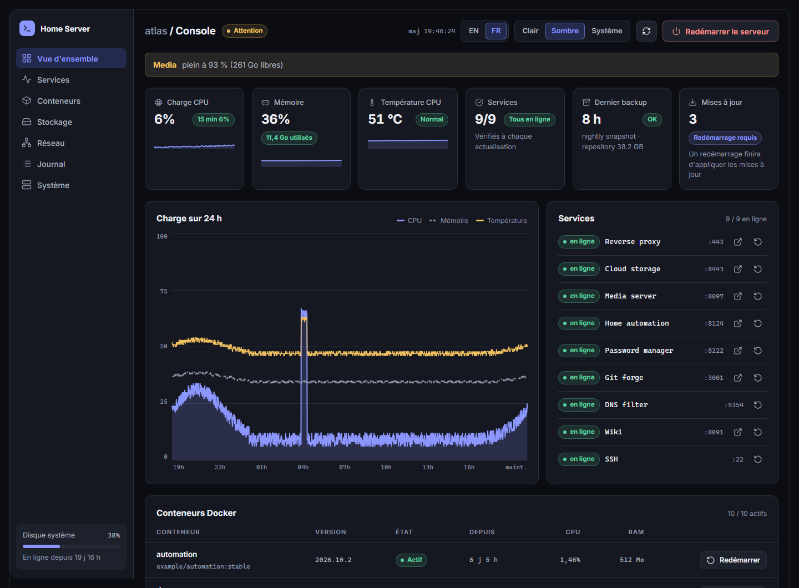
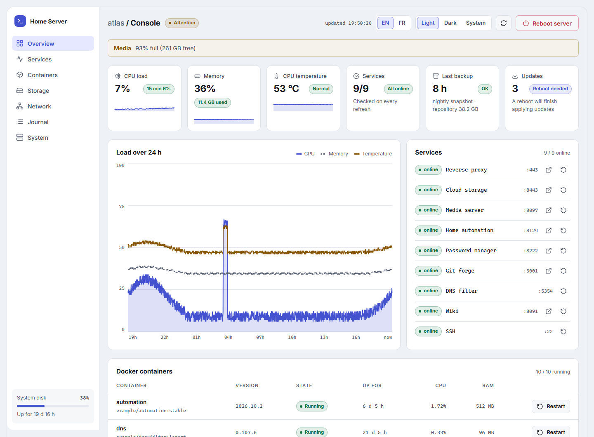
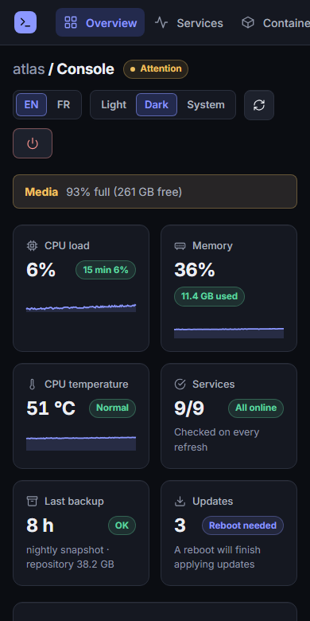

# srv-console

**Une console de supervision légère, suffisante pour un serveur domestique. Elle montre l'essentiel, sans rien de plus.**

Une page d'état pour un serveur Linux que tu héberges toi-même, à la maison ou dans un placard. Charge, mémoire et température, disques et leur santé SMART, conteneurs Docker, les services qui comptent pour toi, expiration des certificats, mises à jour en attente, et surtout : est-ce que la sauvegarde de cette nuit a vraiment tourné. Si tu l'autorises, elle peut aussi redémarrer un conteneur ou la machine entière.

Ce n'est ni Prometheus ni Zabbix, et elle n'essaie pas de l'être. Pas d'agent, pas de base de métriques à faire tourner : une petite application PHP et un timer systemd, sans framework, rien chargé depuis internet.



<p>
  
  
</p>

Toutes les captures utilisent des données inventées, voir [Essayer sans serveur](#essayer-sans-serveur).

## Ce qu'elle affiche

- **Six tuiles en haut** : charge CPU, mémoire, température du CPU, services, dernier backup, mises à jour en attente. Les trois premières portent une courbe des deux dernières heures.
- **Un graphique sur 24 heures** du CPU, de la mémoire et de la température, un point par minute.
- **Toutes les alertes dans un seul bandeau** : un service qui ne répond pas, un conteneur qui échoue à son contrôle de santé, un disque presque plein, un SMART en échec, un backup en échec ou trop ancien, un certificat qui va expirer, des mises à jour de sécurité en attente, un CPU brûlant, un collecteur arrêté. Les seuils se règlent dans la config.
- **Les conteneurs Docker** avec état, santé, durée de fonctionnement, version, CPU et mémoire.
- **Les disques** : espace utilisé par point de montage, et statut SMART de chaque disque avec température et usure. Un disque en veille reste en veille.
- **Le réseau** : débit actuel par interface et courbe du débit reçu sur 24 heures.
- **Les services** : des tests TCP que tu listes toi-même, avec un lien « ouvrir » et, si tu l'actives, un bouton de redémarrage.
- **Un journal** des évènements récents et des alertes en cours, dans une seule liste défilante.
- **Certificats et connexions** : dates d'expiration Let's Encrypt et dernières connexions.
- Français et anglais (choisis d'après le navigateur, modifiables dans l'en-tête), sombre par défaut, clair et « suivre mon système » en option, lisible sur téléphone.

Tout ce qui demande une commande (Docker, `df`, `smartctl`, `last`, apt) est fait par un collecteur séparé, jamais par la page web. Cette séparation est le choix de conception principal, expliqué plus bas.

## Fonctionnement

```
navigateur --> api/state.php --> lit /proc, /sys et /var/lib/srv-console/status.json
                                                    ^
timer systemd, chaque minute --> srv-console-collect (root) --> docker, df, smartctl, last, certificats, apt

navigateur --> api/action.php --> sudo --> srv-console-action (root) --> docker restart / systemctl
```

Le serveur web tourne sous un utilisateur sans privilèges, qui ne peut pas parler à Docker, lire les données SMART ni lister les connexions, et c'est très bien comme ça. Un petit collecteur tourne donc en root une fois par minute, rassemble tout ça et écrit des fichiers JSON. La page se contente de les lire, plus quelques infos de `/proc` et `/sys` lisibles par tout le monde. Les requêtes restent rapides, et un bug dans la page, ou une page exposée par erreur, ne peut lancer aucune commande.

Le seul sens inverse, c'est le bouton de redémarrage facultatif, via un assistant root qui revérifie chaque demande, voir [Actions](#actions-redémarrage-et-reboot).

## Prérequis

- Linux avec systemd. Construite et utilisée sur Ubuntu 24.04 avec Apache 2.4 et PHP 8.3. Debian et les autres versions d'Ubuntu devraient marcher, le reste n'est pas testé.
- PHP 8.1 ou plus récent, à la fois en ligne de commande (pour le collecteur) et pour ton serveur web (mod_php ou php-fpm). L'extension `openssl` n'est nécessaire que pour la carte des certificats.
- Apache ou nginx. Des exemples de configuration sont dans `deploy/`.
- Facultatif. Chacun de ces éléments n'ajoute une carte que s'il est présent : Docker, `smartmontools`, certbot (certificats), `update-notifier-common` (le nombre de mises à jour en attente, Ubuntu), et la commande `last` (connexions).

## Essayer sans serveur

Pas besoin d'une machine Linux pour la voir. Avec PHP installé :

```
git clone https://github.com/BriKKou/srv-console.git
cd srv-console
SRV_CONSOLE_DEMO=1 php -S 127.0.0.1:8080 -t public
```

Ouvre http://127.0.0.1:8080. La démo sert un serveur inventé appelé « atlas », d'où viennent les captures. Sous Windows, définis d'abord la variable : `$env:SRV_CONSOLE_DEMO=1` dans PowerShell, ou `set SRV_CONSOLE_DEMO=1` dans cmd.

## Installation

Sur le serveur, en root ou avec sudo.

**1. Mets le code dans /opt et fais-en la propriété de root.**

```
git clone https://github.com/BriKKou/srv-console.git /opt/srv-console
chown -R root:root /opt/srv-console
chmod 755 /opt/srv-console/bin/*
```

La propriété compte plus qu'il n'y paraît. Les deux scripts de `bin/` tournent en root et chargent des fichiers PHP depuis `src/`. Si ton utilisateur web pouvait écrire là, il pourrait faire exécuter n'importe quoi par root. Garde tout l'arbre à root, modifiable par personne d'autre.

**2. Crée ta configuration.**

```
install -d /etc/srv-console
cp /opt/srv-console/config/config.example.php /etc/srv-console/config.php
```

Modifie-la. Chaque option est commentée, et tout ce que tu laisses de côté garde sa valeur par défaut : une config peut tenir en cinq lignes. Voir [Configuration](#configuration).

**3. Lance le collecteur.**

```
cp /opt/srv-console/deploy/srv-console-collect.{service,timer} /etc/systemd/system/
systemctl daemon-reload
systemctl enable --now srv-console-collect.timer
```

Laisse-lui une minute, puis vérifie que `/var/lib/srv-console/status.json` existe. Sinon, `journalctl -u srv-console-collect` dit pourquoi.

**4. Sers `public/`.**

Pars de `deploy/apache.conf` ou `deploy/nginx.conf`. Dans les deux cas, protège-la par une authentification HTTP ou restreins-la à ton réseau local : la page n'a pas de connexion propre. Lis [Sécurité](#sécurité) avant de l'exposer au-delà de ton réseau.

**5. Facultatif : active les boutons de redémarrage.** Voir [Actions](#actions-redémarrage-et-reboot).

## Configuration

La configuration est un fichier PHP qui renvoie un tableau. `config/config.example.php` documente chaque option. Voici celles que tu toucheras en premier :

| Clé | Ce qu'elle fait |
|---|---|
| `title` | Nom affiché dans la barre latérale et l'onglet |
| `language` | `auto` (navigateur, avec un sélecteur dans l'en-tête), `en` ou `fr` |
| `refresh` | Secondes entre deux actualisations de la page, 15 par défaut |
| `services` | Les tests TCP, chacun avec un `name`, un `port` et en option une `url`, un `container` ou une `unit` |
| `actions` | Boutons de redémarrage et de reboot, tous désactivés par défaut |
| `disks.labels` | Des noms plus parlants pour les points de montage |
| `disks.ignore` | Points de montage à masquer (`/boot/efi` et les montages internes de Docker sont déjà masqués) |
| `smart.exclude` | Disques à laisser tranquilles |
| `backup.status_file` | Chemin du fichier qu'écrit ton job de backup |
| `thresholds` | Quand les alertes de disque et de température passent à l'orange et au rouge |

Quelques options lisent aussi l'environnement, surtout pour les tests : `SRV_CONSOLE_CONFIG` (chemin de la config), `SRV_CONSOLE_DATA_DIR` et `SRV_CONSOLE_DEMO=1`. L'assistant root les ignore volontairement.

### Collecteur

`srv-console-collect` tourne en root chaque minute et écrit deux fichiers dans `data_dir` (`/var/lib/srv-console` par défaut) : `status.json` avec le dernier instantané, et `history.json` avec les 24 dernières heures, un point par minute. SMART et le nombre de mises à jour en attente sont rafraîchis toutes les dix minutes à la place. Si le collecteur s'arrête plus de cinq minutes, la page le signale.

Pour SMART, le collecteur demande les disques à `smartctl --scan` et essaie plusieurs types de périphérique sur chacun, parce que le scan annonce parfois un disque SATA comme du simple SCSI, ce qui cache sa santé. Les disques en veille ne sont pas réveillés. Certains vieux disques se comportent mal quand on les interroge : mets-les dans `smart.exclude`, qui compare le chemin du périphérique, les noms de `/dev/disk/by-id` et le modèle. Certains boîtiers USB ne sont pas lisibles du tout ; si tu connais le bon type `-d`, liste le disque dans `smart.devices`.

### Actions (redémarrage et reboot)

Désactivées par défaut. Une fois activées, un bouton de redémarrage apparaît à côté de chaque conteneur et de chaque service que tu as relié à un `container` ou une `unit`, plus un bouton de reboot facultatif dans l'en-tête.

```php
'actions' => [
    'enabled'    => true,
    'containers' => ['wiki', 'gitea'],   // ou 'all'
    'units'      => ['nginx'],
    'reboot'     => false,
],
```

Ça fonctionne en trois couches. La page envoie un POST avec un en-tête personnalisé, qu'un autre site web ne peut pas envoyer. Le point d'entrée vérifie la demande d'après ta config et d'après les conteneurs que le collecteur a vus. Puis il lance `sudo srv-console-action`, un script root qui ne lit que `/etc/srv-console/config.php`, revérifie tout d'après ce qui existe à l'instant, et seulement alors lance `docker restart` ou `systemctl`. Chaque demande, acceptée ou refusée, va dans le journal système : `journalctl -t srv-console-action`.

Pour que sudo l'autorise, installe la règle de `deploy/sudoers` (change le nom d'utilisateur si ton serveur web ne tourne pas sous `www-data`) :

```
install -m 440 /opt/srv-console/deploy/sudoers /etc/sudoers.d/srv-console
visudo -cf /etc/sudoers.d/srv-console
```

Le bouton de reboot demande une confirmation, puis de taper REBOOT.

Le compromis, sans détour : quiconque peut ouvrir la page peut redémarrer ce que tu as autorisé. C'est pourquoi la page doit être derrière une connexion ou sur ton réseau local avant d'activer ça.

### Statut du backup

La tuile de backup ne lance pas de sauvegarde et se moque de l'outil que tu utilises. Elle lit un petit fichier JSON que ton job de backup écrit quand il termine :

```json
{
  "ok": true,
  "last_run": "2026-10-31T03:30:12+00:00",
  "last_success": "2026-10-31T03:30:12+00:00",
  "detail": "nightly, 12 GB added"
}
```

`ok` dit comment s'est passé le dernier passage. `last_run` et `last_success` sont des dates ISO 8601, et `last_success` vaut `last_run` par défaut quand `ok` est vrai. `detail` est un texte facultatif affiché sous la tuile, 200 caractères au maximum. Pointe `backup.status_file` vers ce fichier.

Depuis un script shell, à la fin du job :

```sh
status=/var/lib/backup/status.json
now=$(date -Is)
printf '{"ok": true, "last_run": "%s", "last_success": "%s", "detail": "%s"}\n' "$now" "$now" "12 GB added" > "$status.tmp"
mv "$status.tmp" "$status"
```

Écris sous un nom temporaire puis renomme, pour que le collecteur ne lise jamais un fichier à moitié écrit. En cas d'échec, écris `"ok": false` et mets la raison dans `detail` (sans guillemets ni retours à la ligne, sauf si tu les échappes) : elle apparaît dans l'alerte. La page lève aussi un avertissement quand le fichier est absent, et un autre quand le dernier succès date de plus de `backup.max_age_hours`, 48 par défaut.

## Sécurité

L'application n'a pas de connexion. Mets-la derrière l'authentification de ton serveur web ou restreins-la à ton réseau local, et fais-le pour la page, les ressources et l'API, pas seulement la page d'accueil. Les deux configurations d'exemple le font.

Vérifie aussi ton virtual host par défaut. Une requête qui ne correspond à aucun de tes virtual hosts (une adresse IP, un nom inconnu) est servie par le premier ou celui par défaut. Si celui-là pointe vers ce dossier sans connexion, toute la console est ouverte à quiconque tape ton IP. Teste : `curl -k https://<ton-ip>/` ne doit pas renvoyer le dashboard.

Si quelqu'un entre quand même, il voit le nom de la machine, les adresses des interfaces, les noms et images des conteneurs, les points de montage, et les noms d'utilisateur et adresses sources des dernières connexions. Considère la page comme privée.

Ce que l'application fait pour se protéger : l'utilisateur web ne lance jamais de commande, sauf via l'unique assistant root décrit plus haut. La page envoie une Content-Security-Policy stricte, ne charge rien depuis l'extérieur et construit son DOM sans `innerHTML`. L'API répond 405 à une mauvaise méthode, et la page comme l'API sont envoyées avec `no-store`.

Et une dernière fois, parce que c'est celle qui coûte cher : garde `/opt/srv-console` à root.

## Dépannage

**« Le collecteur n'a pas encore tourné. »** Regarde `systemctl status srv-console-collect.timer` et `journalctl -u srv-console-collect`. Les causes habituelles : un mauvais chemin dans le fichier de service, ou pas de PHP en ligne de commande.

**Pas de carte des conteneurs.** Elle se masque quand Docker est injoignable. Lance `docker ps` en root : c'est ce que fait le collecteur.

**Pas de température.** La page lit la sonde d'un pilote CPU connu (coretemp, k10temp, zenpower, cpu_thermal) et se rabat sur la première zone thermique. Regarde `cat /sys/class/hwmon/hwmon*/name` et `/sys/class/thermal/thermal_zone0/temp`.

**Un disque manque dans SMART.** Lance `smartctl --scan`, puis `smartctl -a /dev/sdX`. Si smartctl ne le lit pas, le dashboard non plus. Sinon, vérifie `smart.exclude`.

**Pas de boutons de redémarrage.** `actions.enabled` doit être vrai, le conteneur doit figurer dans `actions.containers` (ou ce doit être `'all'`) et avoir été vu par le collecteur, et la règle sudoers doit exister. Teste le dernier maillon à la main : `sudo -u www-data sudo -n /opt/srv-console/bin/srv-console-action restart <nom>`. Si sudo se plaint que le drapeau « no new privileges » est positionné, ton unité PHP-FPM est isolée avec `NoNewPrivileges` et sudo ne peut pas fonctionner depuis elle.

**La page est dans la mauvaise langue.** Avec `language` sur `auto`, le sélecteur de l'en-tête l'emporte (il est gardé dans un cookie), puis le navigateur. Mets `en` ou `fr` pour en forcer une.

**Une page blanche et un 401.** C'est ton serveur web qui demande une connexion, comme prévu.

## Structure du dépôt

```
public/            ce que sert le serveur web
public/api/        state.php, history.php, action.php
public/assets/     app.js, app.css, l'icône, et i18n/ avec les textes anglais et français
src/               les classes PHP
bin/               srv-console-collect et srv-console-action, tous deux lancés en root
config/            config.example.php
deploy/            unités systemd, règle sudoers, exemples Apache et nginx
screenshots/       les images de ce README, toutes issues des données de démo
```

La version anglaise de ce fichier est `README.md`.

## Crédits

L'apparence s'inspire du snippet [« Dark developer console dashboard »](https://uicookies.com/snippets/dark-developer-console-dashboard/) d'UICookies. Aucun de leurs fichiers n'est inclus : le HTML, le CSS et le JavaScript de ce dépôt sont écrits de zéro. L'idée d'une page PHP unique pour un serveur maison vient d'eZ Server Monitor.

## Licence

MIT, voir `LICENSE`.
